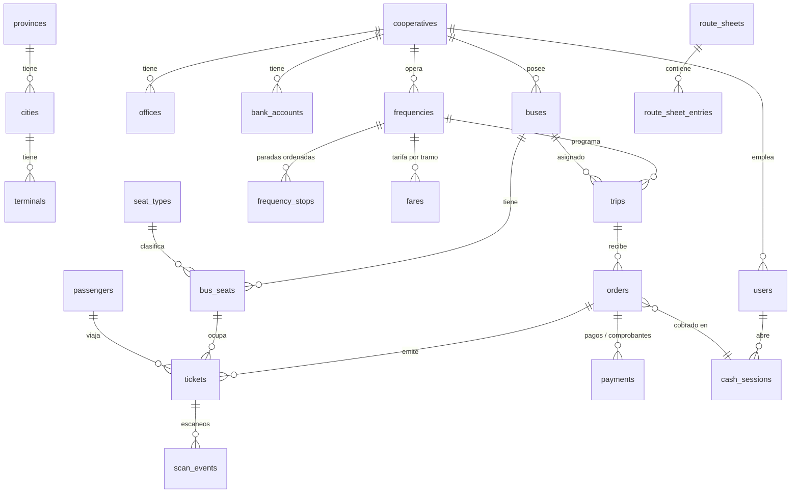

# Base de datos

Archivo: `server/schema.sql` (SQLite, `PRAGMA foreign_keys = ON`, modo WAL). 32 tablas. Dinero en centavos; fechas locales de Ecuador como texto.

## Diagrama (núcleo)

## Tablas por dominio

| Dominio | Tablas |
|---|---|
| Configuración | `settings` (clave/valor JSON: marca, reglas, textos legales) |
| Geografía | `provinces`, `cities`, `terminals` |
| Organización | `cooperatives`, `offices`, `bank_accounts`, `users` (7 roles) |
| Flota | `bus_groups`, `buses`, `seat_types`, `seat_templates`, `bus_seats` |
| Operación | `frequencies`, `frequency_stops`, `fares`, `season_rules`, `route_sheets`, `route_sheet_entries`, `trips` |
| Ventas | `passengers`, `orders`, `tickets`, `payments`, `cash_sessions`, `print_jobs` |
| Control | `scan_events`, `incidents`, `ratings` |
| Transversal | `notifications`, `email_log`, `audit_logs` |

## Restricciones importantes

- `tickets`: el solape de tramos por asiento se valida en la transacción de `createOrder` (no se puede expresar con un `UNIQUE` simple); `public_id` y `short_code` son únicos.
- `orders.status`, `payments.status`, `tickets.status`, `trips.status`, `users.role`, `buses.status` usan `CHECK` con valores válidos.
- `frequencies` único por `(coop, origen, destino, hora)`; `trips` único por `(frecuencia, fecha, hora)`.
- `fares(frequency_id, from_ord, to_ord)` es la matriz de tarifas por par de paradas.
- `payments`: detección de duplicados por `proof_hash` y por `(banco, referencia, monto)` en la lógica de subida.

## Datos de demostración

`server/seed.js` (determinista: PRNG con semilla fija) crea geografía de 12 provincias y 14 ciudades con sus terminales, 3 cooperativas ficticias, buses con asientos (1 y 2 pisos, VIP), frecuencias con paradas y tarifas, hoja de ruta de 29 días (hoy −14 a hoy +14) con rotación y viajes, ventas históricas repartidas en el tiempo y casos específicos de prueba. **Las fechas se calculan respecto al día en que se ejecuta**, por eso el `.zip` no incluye la base: se genera al primer arranque (`npm run db:reset` la regenera).

## Migración a PostgreSQL (recomendada para producción)

1. Cambiar `node:sqlite` por `pg` (o Knex/Prisma) manteniendo `db.prepare().get/all/run` detrás de una pequeña capa.
2. Tipos: `INTEGER PRIMARY KEY` → `BIGSERIAL`; fechas de texto → `timestamp` (o conservar texto); `CHECK` se mantienen.
3. Transacciones: `createOrder`/`issueTickets` pasan a `BEGIN … COMMIT` con `SELECT … FOR UPDATE` sobre el viaje para serializar ventas.
4. Añadir `EXCLUDE USING gist` (extensión `btree_gist`) para impedir solapes de tramo por asiento a nivel de BD.
